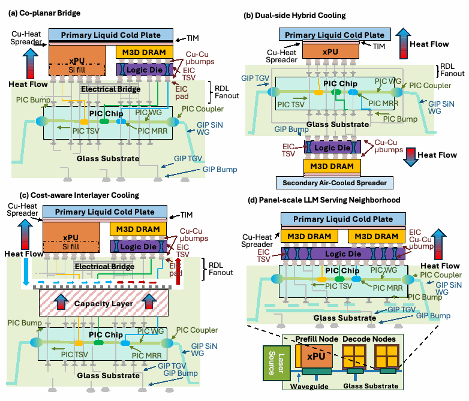
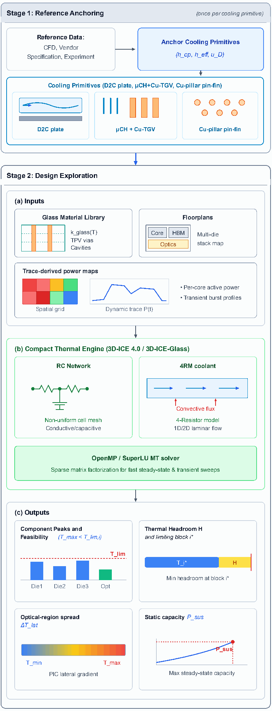
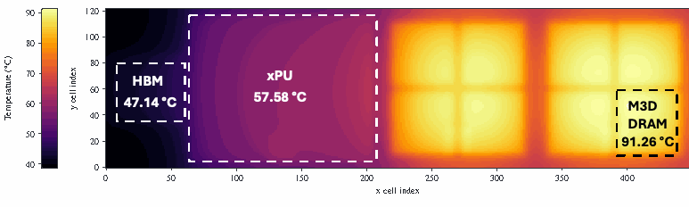

# 3D-ICE-Glass

**Calibrated thermal exploration of glass packages, embedded cooling, and photonic AI serving architectures.**

3D-ICE-Glass supplies package stacks, floorplans, calibrated cooling inputs, and reproducible run tools around **EPFL's unmodified 3D-ICE 4.0 engine**. It models co-planar compute/memory bridges, dual-side cooling, embedded capacity tiers, and a panel-scale prefill/decode neighborhood. The thermal solver is developed by the [Embedded Systems Laboratory at EPFL](https://github.com/esl-epfl/3d-ice); this repository contributes the glass-package research workflow and inputs.

Start with [installation](#installation), run the [small validation example](#first-simulation), then choose an [architecture](#architecture-models). The [complete input index](docs/case-index.md) links **every released `.stk` and `.flp`** to its dependencies and academic sources.

> **Reproduction status:** imported inputs are preserved byte for byte and have SHA-256 provenance. Some historical inputs differ from the supplied manuscript. Consult [release verification and paper/input differences](docs/reproduction-status.md) before treating a run as an exact paper reproduction.

## Repository map

```text
3D-ICE-Glass/
├── vendor/3d-ice/          Complete, unmodified EPFL solver snapshot and user guide
├── validation/
│   ├── Baselines/         All research files from the supplied local Baselines folder
│   └── supplemental/      Missing dependencies and additional server checkpoints
├── models/
│   ├── co-planar/         Shared cold plate: water and warm-loop endpoints
│   ├── dual-side/         Liquid-only, dual-liquid, forced-air, warm-loop variants
│   ├── interlayer/        E0/E1/E2/E4 and HyFlexPIM embedded-capacity variants
│   └── panel/             Trace floor, workload/TDP provisioning, warm-loop endpoints
├── tools/                 Build, isolated run, integrity check, input catalog
├── docs/                  Calibration, citations, model index, manuscript figures
├── provenance/            Original locations, SHA-256 hashes, upstream revision
├── build/                 Generated solver build (ignored by Git)
└── runs/                  Generated simulations and plots (ignored by Git)
```

The transient extension lives on [`codex/transient-demo`](https://github.com/bmscott73/3D-ICE-Glass/tree/codex/transient-demo). It adds `demo/inputs`, `demo/analysis`, and `demo/reference`, including the saved 1000–1010 s workload window and a five-minute presentation guide.

## Installation

### Linux native build

The documented build uses Ubuntu/Debian, GCC/OpenMP, OpenBLAS, and SuperLU MT 4.0.0. The release was built and run in Ubuntu 24.04 on Linux ARM64 through Docker Desktop; the original research server uses Linux x86-64. The bundled solver source is pinned to EPFL commit [`e0bb6850c5e446363e26936586d625270c87f224`](https://github.com/esl-epfl/3d-ice/commit/e0bb6850c5e446363e26936586d625270c87f224). A clean build uses this snapshot, rather than whichever revision upstream currently serves.

```bash
sudo apt-get update
sudo apt-get install -y build-essential bison flex libopenblas-dev csh unzip python3 python3-venv git

git clone https://github.com/bmscott73/3D-ICE-Glass.git
cd 3D-ICE-Glass
python3 tools/check_inputs.py
bash tools/build.sh
```

The executable is `build/3d-ice/bin/3D-ICE-Emulator`. Build logs are `build/superlu-build.log` and `build/3d-ice-build.log`. The build script copies the pinned source into `build/`; it preserves `vendor/3d-ice/`. If a build fails, inspect the logs and rename the failed build directory before retrying.

For plotting and the transient demo, install the optional analysis dependencies:

```bash
python3 -m venv .venv
. .venv/bin/activate
python3 -m pip install -r requirements-analysis.txt
```

The released rectangular floorplans require no GDS extraction, Modelica, SystemC, or pluggable heatsink installation. Those optional upstream features are described in the [EPFL user guide](vendor/3d-ice/doc/3D-ICE-User_Guide.pdf). The upstream `make test` target also builds plugins and needs their additional dependencies.

### macOS / Windows with Docker

Use the Linux container for the solver. The image also includes the Python analysis dependencies; analysis can run locally if preferred.

```bash
docker build -t 3d-ice-glass .
mkdir -p runs
docker run --rm \
  --mount "type=bind,src=$(pwd)/runs,dst=/opt/3d-ice-glass/runs" \
  3d-ice-glass validation/Baselines/H100/ttv_interpack.stk
```

Large architectural stacks need substantially more memory than the first example. Allocate sufficient container memory, or use a Linux workstation/server. Published inputs retain their original grids and 12-core solver setting; `--cores N` changes only the staged run's thread count.

## First simulation

From the repository root:

```bash
python3 tools/run_case.py validation/Baselines/H100/ttv_interpack.stk
```

This small copper thermal test vehicle injects **700 W** over **26 × 35 mm**, with the effective two-phase boundary anchored at `h = 43,956 W/m²K` and `T_ref = 320.65 K`. It checks the **case boundary and thermocouple proxy**, rather than an H100 silicon junction. Its default case-surface closure is approximately 65 °C; the supplied manuscript's 720 W checkpoint is a different input that has not been located.

The command creates `runs/ttv_interpack/` with the staged stack, floorplans, `run.json`, `simulator.log`, and `outputs/`. All simulator temperature outputs are **kelvin**; convert to °C by subtracting **273.15**. An existing run directory is never overwritten; use `--run-dir runs/my-next-run` for another run.

Prepare a case without running the solver:

```bash
python3 tools/run_case.py models/panel/warm-loop/pan-tdp-735.stk \
  --run-dir runs/panel-preview --prepare-only
```

## Architecture models



| Architecture | Released cases | Cooling / workload distinction | Validation primitive |
|---|---|---|---|
| [Co-planar bridge](models/co-planar/README.md) | `static-standard`, `cp-h300`, `cp-h234` | Shared top liquid plate; 300 K water and 308 K property endpoints | [Stratum-S](validation/Baselines/Stratum-S/stratum_S_v2_liquid.stk), [H200 plate](validation/Baselines/H200/h200_stratum_htc_probe.stk) |
| [Dual-side hybrid](models/dual-side/README.md) | `d2-noplate`, `d2-standard`, `d2air-3ms`, `d2air-4ms`, two bounded 4 m/s cases | Top liquid plus absent, liquid, or air secondary sink | Same plate/stack anchors; [ATS air-sink specification](docs/references.md#air) |
| [Interlayer cooling](models/interlayer/README.md) | `emb-E0/E1/E2/E4-std`, `emb-H1/H1M2-std`, `emb-E4-735/575` | 4RM glass cavity, embedded memory/PIM capacity, water vs glycol-property envelope | [Anchored HyFlexPIM channel](validation/supplemental/coefficient-comparison/hfp_tgv_E1c_anchored.stk), [Cu-pillar vehicle](validation/supplemental/cu-pillar/estc_cupillar_pinfin_active1mm_p111.stk) |
| [Panel neighborhood](models/panel/README.md) | `pan-std`, `pan-wl`, `pan-tdp`, `pan-tdp-735/575`, `pan-wl-575` | One prefill and two decode nodes; trace-floor / workload / configuration-TDP maps | Plate anchor and [photonic comparison](validation/supplemental/photonic/cpo_3d.stk) |

Example architecture run:

```bash
python3 tools/run_case.py models/panel/warm-loop/pan-tdp-735.stk --cores 12
```

## Calibrated assumptions

The protocol is **anchor once, freeze, then evaluate transfer within the same cooling domain**. A new coolant, geometry, contact area, or flow regime requires a new anchor. See [calibration and units](docs/calibration.md) for the full assumptions and [validation models](validation/README.md) for the observed physical plane and checkpoint status.

| Quantity | Released convention / anchor |
|---|---|
| Length / power / temperature / time | µm / W / K / s; flow rate in mL/min; Darcy velocity in µm/s |
| Cold-plate Robin boundary | Water `h_cp = 4.08e-8 W/µm²K = 40,800 W/m²K`; retain applied area and `G = hA` |
| Glass µCH/Cu-TGV 4RM boundary | Frozen CFD anchor `h_eff = 1.27e-8 W/µm²K`; HyFlexPIM flow 156.5 mL/min |
| Interlayer package cavity | 197 channels, 237.2 mL/min; water inlet 300 K; same calibrated velocity domain |
| Warm-loop property envelope | Plate approximately `0.735 h_water` or `0.575 h_water`; cavity uses `0.735` at both endpoints; it is a sensitivity envelope |
| Material anisotropy | Orthotropic Cu-TGV composite; numeric properties and layer thicknesses are explicit in each stack |
| Feasibility | Manuscript comparison ceiling 85 °C; headroom is the minimum margin across blocks |
| Photonics | Report PIC / corridor temperature spread; allowable wavelength drift and tracking rate require device-specific inputs |



## Results and reproducibility



The figure is a **manuscript illustration**, not an output regenerated by this README. The case corresponding to this boundary is [pan-tdp-575.stk](models/panel/warm-loop/pan-tdp-575.stk). Its numerical grid is 200 × 200 µm. The model index records the active grid, source power, and boundary in every case.

```bash
python3 tools/check_inputs.py   # hashes, floorplan dependencies, power queue consistency
python3 tools/catalog.py        # regenerate the .stk/.flp index
```

[Reproduction status](docs/reproduction-status.md) distinguishes imported data, release tests, supplied manuscript results, and missing exact checkpoints. In particular, the panel source power sums are **942.03 / 1119.63 / 1361.01 W**, consistent with the manuscript's rounded totals; older script headers contain a 6.1 W accounting discrepancy. Active input statements take precedence over stale comments.

## Citation and license

Please cite **3D-ICE-Glass** and the underlying **3D-ICE** publications when using this workflow. The supplied manuscript is titled *3D-ICE-Glass: Calibrated Thermal-Aware Floorplanning of Photonic Glass Packages for Scalable AI*. It omits authors for blind review; a public author list, publication status, and DOI have not been supplied. Do not invent an accepted DATE 2027 citation. [Academic references](docs/references.md) include the four publications requested by EPFL, architecture sources, cooling anchors, and links used by every model. [BibTeX](docs/references.bib) is provided for verified public papers.

Solver source, release tools, and model inputs are distributed under **GPL-3.0-or-later**; see [LICENSE](LICENSE) and [NOTICE](NOTICE). The vendored engine retains EPFL's original copyright and license notices, and bundled dependencies retain their own licenses. Manuscript figures retain their authors' attribution. [Upstream provenance](provenance/upstream.json) and [input provenance](provenance/files.json) record exactly what was imported.
