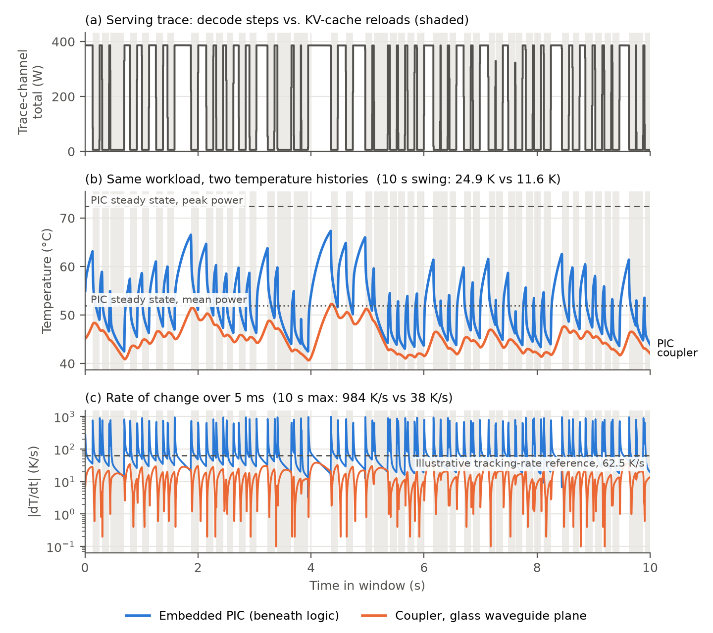
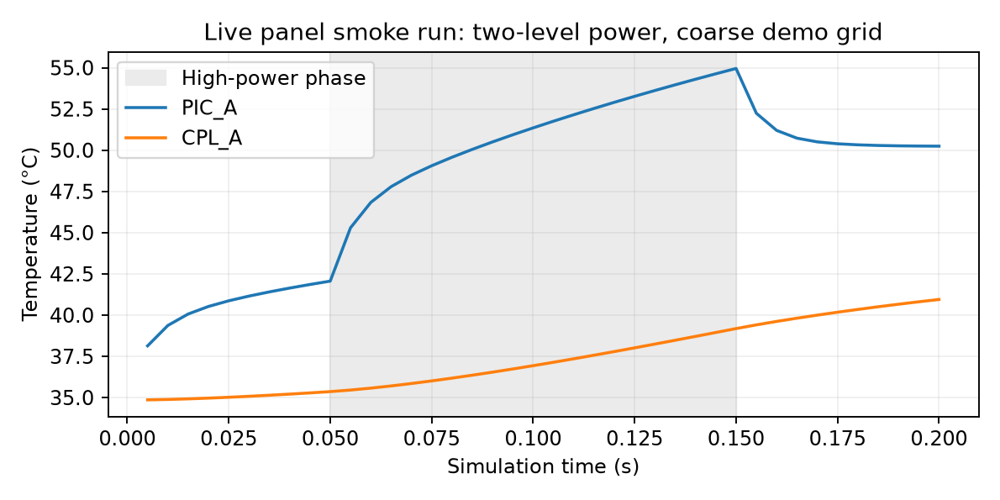

# Transient thermal extension: five-minute demo

The extension is part of **main**. It compares a panel workload's temperature histories with static window-mean, window-peak and TDP predictions, using the same calibrated plate and native 3D-ICE engine as the architecture studies.

## Regenerate the saved result

With the [analysis dependencies](../docs/installation.md) installed:

```bash
python3 transient/run_demo.py reference
```

This recreates the metrics CSV/PNG and full/zoom figures from saved Tflp traces and checks all **19 non-fill block metrics** against the reference. It needs no compiled solver. Results are in `runs/transient-reference/`. This is reference-trace analysis; it is distinct from a new thermal solve.



## Five-minute walkthrough

| Time | Action | Explain |
|---|---|---|
| 0:00–0:45 | Show [panel architecture](../models/panel/README.md) | One prefill node, two decode nodes, buried PICs and glass-plane couplers |
| 0:45–1:30 | Run `python3 transient/run_demo.py reference` | Regenerate the scientific result from saved temperature traces |
| 1:30–3:00 | Open the generated full/zoom figures | The same workload produces different PIC and coupler temperature histories |
| 3:00–4:15 | Show PIC_A and CPL_A metrics | Compare swing/slew and static mean/peak predictions |
| 4:15–5:00 | Run the prepared live smoke case below | Demonstrate a new transient solve with explicit grid and power pulse |

Build the solver before presenting. The walkthrough does not include a clean install or a complete 6000-slot thermal solve.

## Short live simulation

```bash
python3 transient/run_demo.py smoke --cores 2
```

The smoke run uses the panel footprint/layers and **5 ms** step, but a clearly identified **898 × 400 µm coarse grid** (100 × 61 cells) and **40 synthetic power slots**. It starts at 308 K, applies 10 low-power slots, 20 high-power slots, and 10 low-power slots. It checks finite temperatures and a **0.2 s** final time, then writes `smoke.png`, `smoke-check.json`, and staged-change metadata. The measured release run took **5.7 wall seconds** with two threads; runtime varies by machine.



On macOS/Windows:

```bash
docker build -t 3d-ice-glass .
mkdir -p runs
docker run --rm --entrypoint python3 \
  --mount "type=bind,src=$(pwd)/runs,dst=/opt/3d-ice-glass/runs" \
  3d-ice-glass transient/run_demo.py smoke --cores 2
```

For the same synthetic workload on the original **200 × 200 µm grid**:

```bash
python3 transient/run_demo.py smoke --research-grid --cores 2 \
  --run-dir runs/transient-smoke-fine
```

The original-grid release check passed in **268.6 wall seconds**, with **11.50 GB** reported peak memory. Both smoke modes demonstrate solver execution; neither is long enough to establish warm-up or the archived ten-second result. Coarse cells do not resolve small optical features.

## Complete fresh solve

```bash
python3 transient/run_demo.py simulate --cores 12
```

This runs the original transient input and all three static comparisons, regenerates analysis, and compares it with the archive. It may take substantially longer than five minutes. Use `--emulator /absolute/path/to/3D-ICE-Emulator` for an installed stock build and `--run-dir runs/new-name` for another execution. Existing directories are refused.

## Inputs, timing and power interpretation

- [Transient stack](inputs/pan-tdp-735_1000-1010s_5ms.stk): 6000 power samples per block, **20 s warm-up plus 10 s observation**.
- [Slots CSV](inputs/slots_1000-1010s_5ms.csv): source clock **980.000–1009.995 s**; first 4000 slots are warm-up. Solver time starts at zero and ends at 30 s. Figures show the selected 1000–1010 s window relative to its start.
- [Window mean](inputs/pan-tdp-735_mean_1000-1010s_5ms.stk), [window peak](inputs/pan-tdp-735_peak_1000-1010s_5ms.stk), and [TDP](inputs/pan-tdp-735.stk): three distinct static comparisons.
- [Mapping JSON](inputs/pan-tdp-735.map.json): split DRAM among tiles, assign `compute` to logic, and assign `io*0.5` to each decode PIC. Prefill blocks remain constant.

The plate is **2.999e-8 W/µm²K**, its reference and initial state are **308 K**, and the original grid is **200 µm**. No embedded coolant cavity is present in this panel case.

The plotted trace-channel sum is `dram+compute+io` (**6.12–386.79 W**, mean **157.21 W**). It is a CSV channel total; actual injected package power is the sum of all native floorplan queues. Dynamic decode PIC power varies with the `io` channel, while the paper's static architecture maps use 3.05 W PICs. This workload window is a separate transient experiment.

## Reported metrics

**PIC_A:** swing **24.856 K**, maximum 5 ms finite-difference slew **984.2 K/s**, transient maximum **67.365 °C**. Window-mean and window-peak steady predictions are **51.982 / 72.464 °C**.

**CPL_A:** swing **11.647 K**, maximum finite-difference slew **38.0 K/s**.

The plot's **62.5 K/s** reference line is illustrative and configurable. A device-specific optical tracking requirement needs its own data. Slew depends on sampling and output rounding.

[Shared metrics helper](../tools/tflp_metrics.py) · [Plotting helper](analysis/demo_figure.py) · [Reference results](reference/) · [Input integrity](../provenance/transient-files.json) · [Calibration](../docs/calibration.md).
